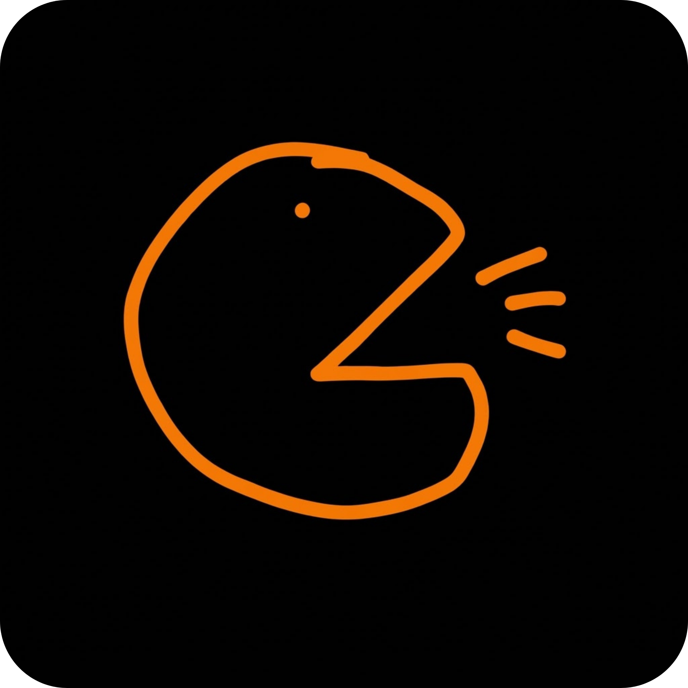
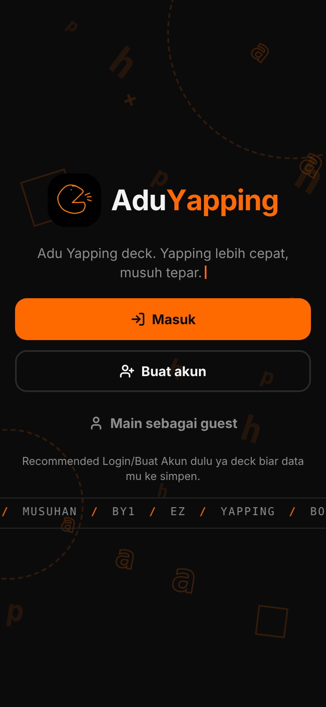
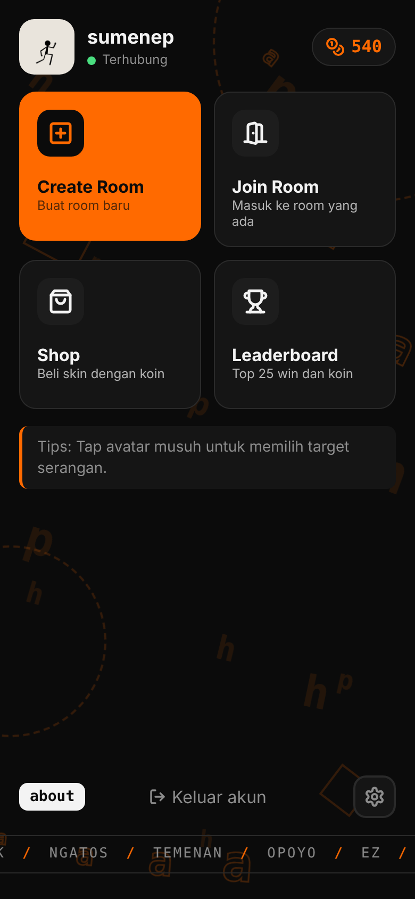
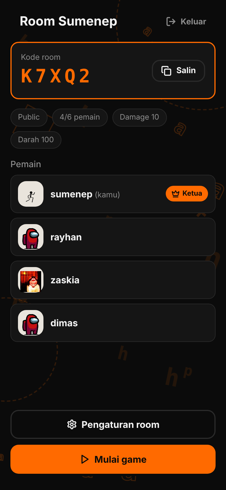
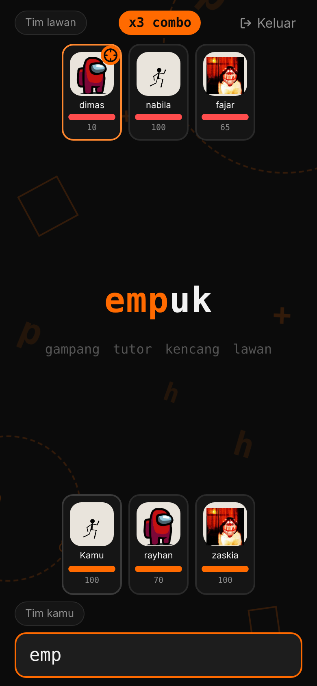
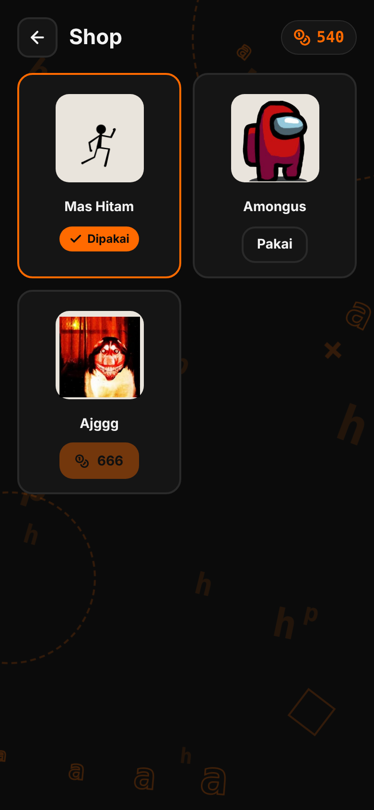
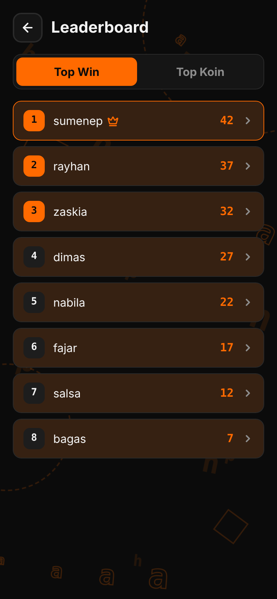

# AduYapping

**Adu ngetik multiplayer, tim lawan tim.**

---

Kamu dan temanmu ngetik kalimat secepat mungkin, tiap kalimat yang selesai menyerang musuh. Tim yang semua anggotanya masih berdiri di akhir, menang.

Mainnya langsung dari browser, di HP maupun laptop. Tidak perlu install apa pun.

## Tampilan

<table>
  <tr>
    <td align="center"> Halaman awal</td>
    <td align="center"> Menu utama</td>
    <td align="center"> Room</td>
  </tr>
  <tr>
    <td align="center"> Pertandingan</td>
    <td align="center"> Toko skin</td>
    <td align="center"> Leaderboard</td>
  </tr>
</table>

## Cara main

1. Masuk dengan akun, atau pilih main sebagai guest.
2. Buat room baru, atau gabung ke room yang sudah ada lewat daftar room atau kode room.
3. Host mengatur room: jumlah pemain, nyawa, damage, dan password kalau mau room privat.
4. Pemain dibagi ke dua tim secara adil. Setelah hitung mundur selesai, ketik kalimat yang muncul.
5. Kalimat yang benar mengurangi nyawa lawan yang sedang kamu incar. Bisa ganti target kapan saja.
6. Tim yang masih punya pemain hidup menang. Pemain dengan kalimat terbanyak jadi MVP.

## Fitur

- Pertandingan tim lawan tim dengan banyak pemain dalam satu room.
- Kalimat dibuat oleh Gemini, jadi hampir tidak pernah sama.
- Room publik atau privat dengan password, lengkap dengan daftar room yang sedang buka.
- Akun dengan username, Gmail, dan password. Lupa password bisa dipulihkan lewat kode yang dikirim ke Gmail.
- Koin dari tiap pertandingan, bisa dipakai beli skin di toko.
- Leaderboard Top Win dan Top Koin. Ketuk nama pemain untuk melihat profilnya.
- Efek suara dan getar di HP, bisa dimatikan di Pengaturan.
- Tampilan oranye hitam yang minimal dan penuh animasi.

## Teknologi

| Bagian | Dipakai |
| --- | --- |
| Tampilan | React, Vite, Framer Motion, Lucide |
| API | Vercel Functions |
| Database | Neon (Postgres) |
| Server game realtime | Cloudflare Workers + Durable Objects (WebSocket) |
| Kalimat | Gemini API |
| Email kode pemulihan | Gmail SMTP |

Server game yang memegang semua aturan: kalimat, hitungan damage, dan hasil akhir. Browser hanya mengirim apa yang kamu ketik, jadi sulit dicurangi.

## Struktur repo

| Folder | Isi |
| --- | --- |
| `web/` | tampilan dan API (Vercel) |
| `worker/` | server WebSocket game (Cloudflare) |
| `db/` | skema dan migrasi database (Neon) |

## Pasang sendiri

Panduan lengkap untuk menjalankan versi sendiri ada di `PANDUAN_DEPLOY.md`.

Rahasia seperti kunci Gemini, URL database, dan secret tidak disimpan di repo. Semuanya diisi di dashboard Vercel dan Cloudflare.

## Pembuat

Dibuat oleh [aldo19271](https://github.com/aldo19271).
